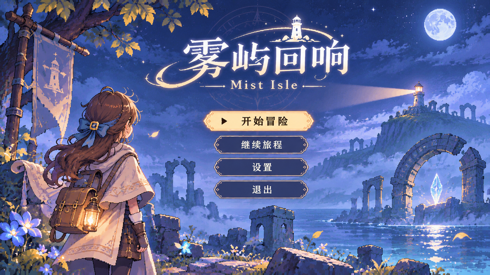
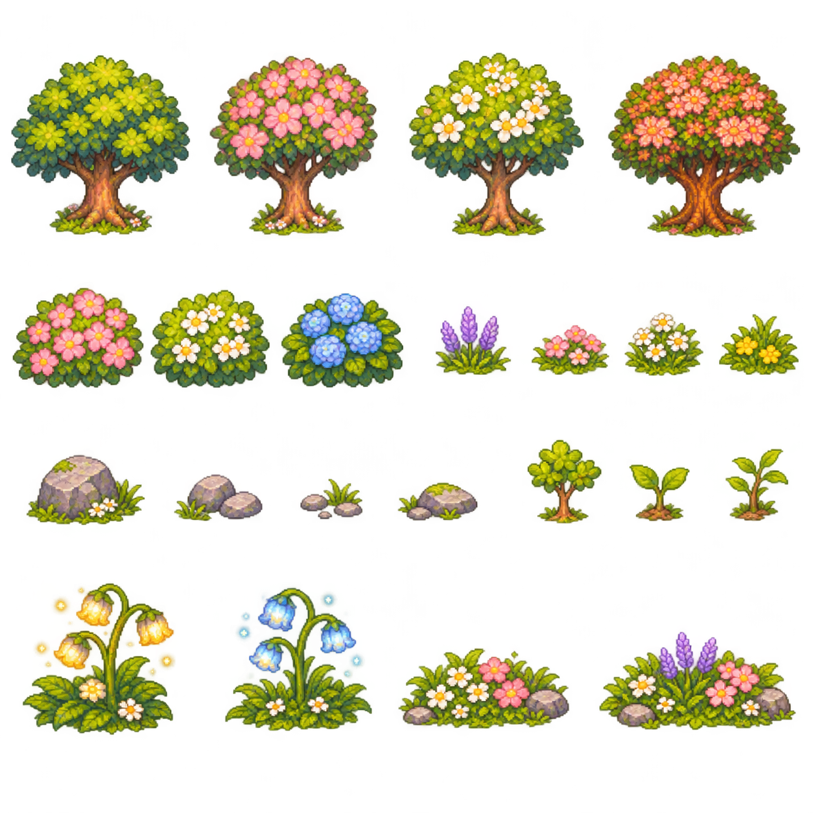
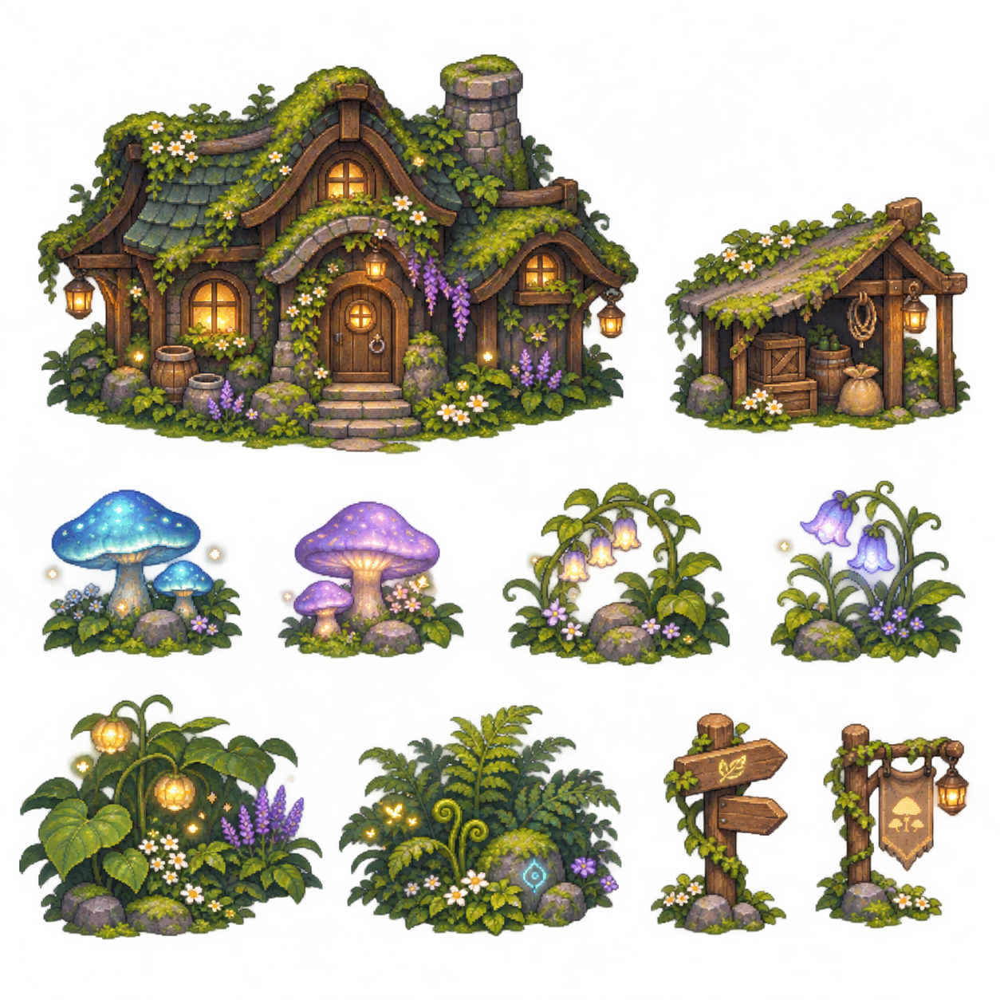
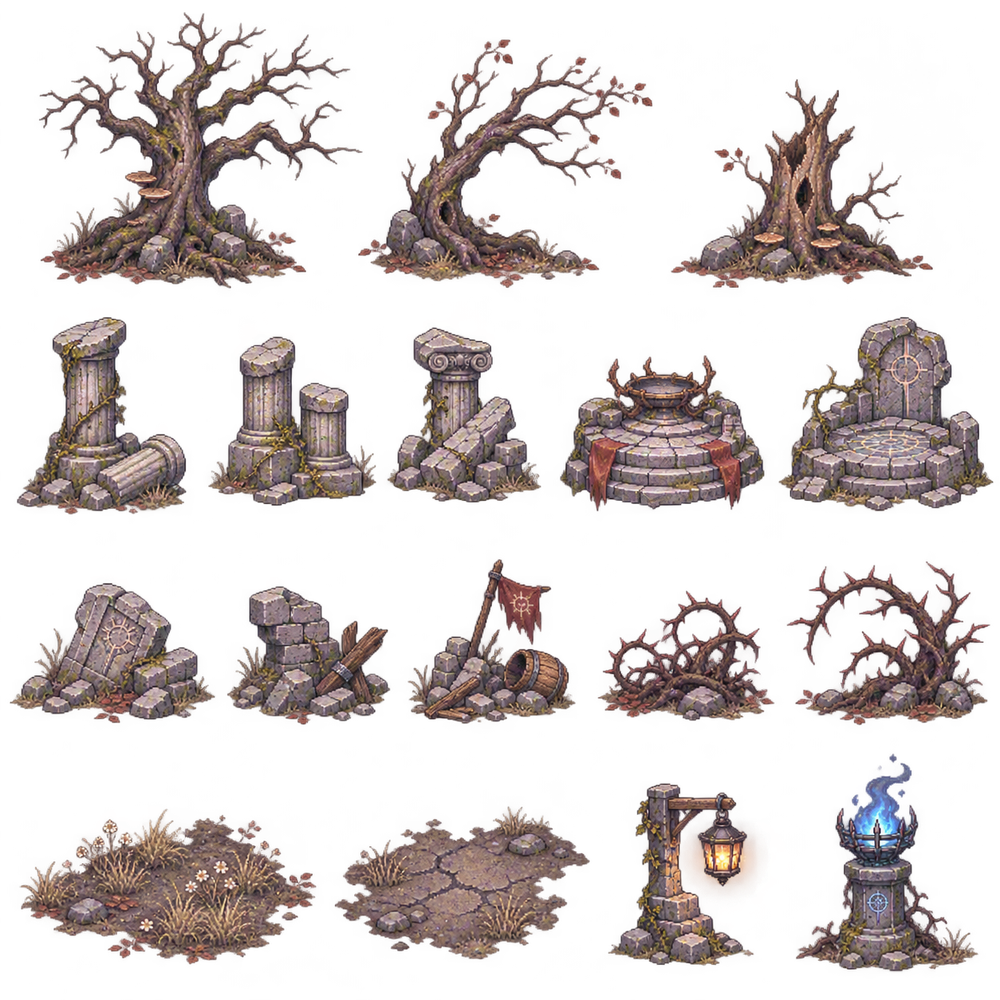
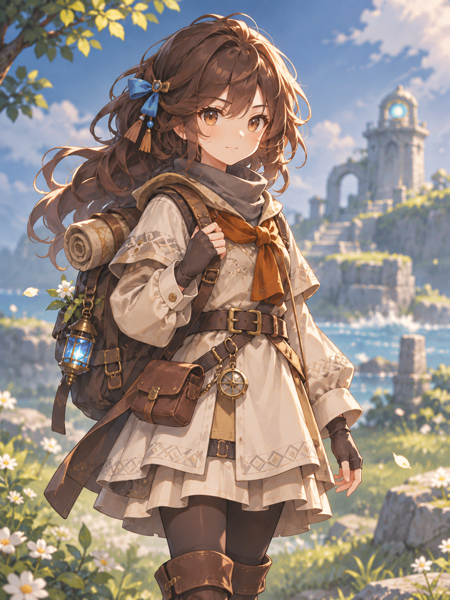
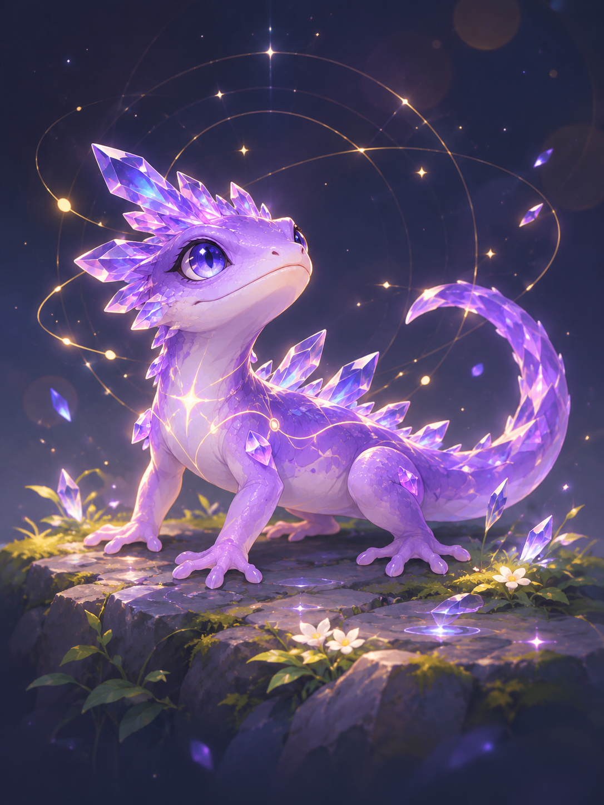
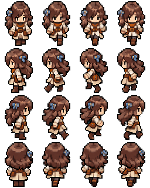
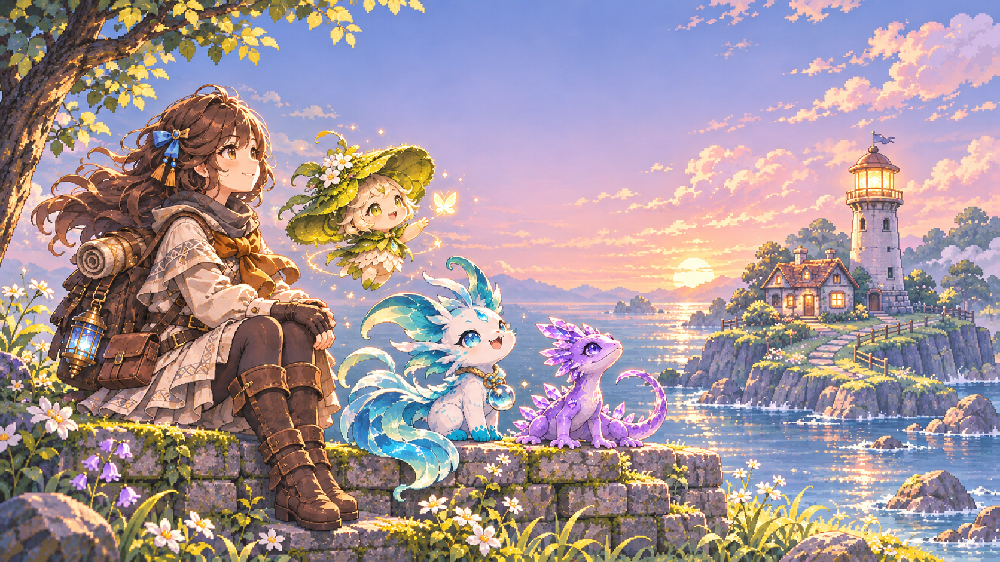

# 雾屿回响 · Mist Isle

<p align="center">
  
</p>
<p align="center"><em>月光照亮遗迹，灯塔指引归途。 / Under the moonlit ruins, the lighthouse guides the way home.</em></p>


<p align="center">
  <strong>一段关于海岛、伙伴与失落灯塔的像素冒险。</strong><br/>
  <em>A handcrafted pixel-art adventure about an island, companions, and a lost lighthouse.</em>
</p>

<p align="center">
  
  
  
  
</p>

---

## 下载与开始 / Download and Play — v3.0.0

| 平台 / Platform | 下载 / Download |
|---|---|
| Windows x64 | [MistIsle-Windows-v3.0.0.zip](https://github.com/xily99371-del/mist-isle/releases/download/v3.0.0/MistIsle-Windows-v3.0.0.zip) |
| Raspberry Pi 5 ARM64 | [MistIsle-RaspberryPi5-ARM64-v3.0.0.tar.gz](https://github.com/xily99371-del/mist-isle/releases/download/v3.0.0/MistIsle-RaspberryPi5-ARM64-v3.0.0.tar.gz) |
| 文件校验 / Checksums | [SHA256SUMS](https://github.com/xily99371-del/mist-isle/releases/download/v3.0.0/SHA256SUMS) |

Windows：完整解压到新文件夹，双击 `mist_isle.exe` 或 `RUN_WINDOWS.bat`；运行包已包含美术、音乐与字体，无需安装开发工具。发行说明及附件以 [v3.0.0 Release](https://github.com/xily99371-del/mist-isle/releases/tag/v3.0.0) 为准。

Windows: extract the whole archive into a new folder and run `mist_isle.exe` or `RUN_WINDOWS.bat`. Art, audio and fonts are included; no build tools are required to play. See the [v3.0.0 Release](https://github.com/xily99371-del/mist-isle/releases/tag/v3.0.0) for notes and attachments.

## 最终地图素材 / Final Map Art — v8

<p align="center">
  
  
</p>
<p align="center">
  
  
</p>
<p align="center"><sub>四张最终地图专属素材图集，直接来自 MistIsle_MapArt_v8.zip。旧版通用地形图集不再作为最终地图美术展示。 / Four final area-specific art sheets extracted from MistIsle_MapArt_v8.zip. Earlier generic atlases are no longer presented as the final map art.</sub></p>

## 高清角色图鉴 / High-Resolution Character Gallery

<p align="center">
  
  
  
</p>
<p align="center"><sub>v7 最终高清角色立绘：女主角、守望者、灯塔守卫 / Final v7 high-resolution portraits: heroine, Watcher and Lighthouse Guardian.</sub></p>

<p align="center">
  
  
  
</p>
<p align="center"><sub>三位伙伴的 v7 高清独立立绘 / Final v7 individual high-resolution companion portraits.</sub></p>

## 正式版游戏内像素形象 / Official In-Game Pixel Sprites

<p align="center">
  
  
  
</p>
<p align="center"><sub>以上三张角色动画均对应 src/render.c 中实际加载的文件路径 / All three sprite sheets use the exact paths loaded by src/render.c.</sub></p>
<p align="center">
  
  
  
</p>
<p align="center"><sub>角色保持正式 v1.0.0 的原始美术与显示比例；女主与守望者为64×80单帧，三伙伴为32×32单帧。 / Character artwork and display proportions match the official v1.0.0 release: 64×80 actor frames and 32×32 companion frames.</sub></p>
<p align="center"><sub>高清对话立绘与游戏内像素动画分开展示。上述高清立绘来自 MistIsle_ApprovedArt_v7.zip，地图环境素材来自 MistIsle_MapArt_v8.zip。 / High-resolution dialogue portraits are shown separately from in-game pixel sprites. Portraits come from v7; environment art comes from v8.</sub></p>

## 中文

### 游戏简介

《雾屿回响》（Mist Isle）是一款俯视角像素 RPG。你将从海岸营地出发，探索一座被遗忘的海岛，与岛上的小生灵结伴，逐步恢复失落灯塔的力量。

v3.0.0 将已验收的最终音效与宠物战斗系统正式接入 v2.0.0 完整旅程。四张地图、探索任务、伙伴招募、音乐和灯塔结局全部保留，不是独立战斗演示。

### v3.0.0 更新

- **三宠战斗**：旅人只指挥，三位伙伴同场并各有固定血条；全队体力耗尽即战败。
- **完整动作反馈**：蓄力、出招、命中、收招；伤害和治疗在命中时结算，敌人自动反击。
- **全队治疗与联动**：苔灯灵为所有已招募宠物恢复体力，包括自身与暂时倒下的队友；泡泡水流后可衔接晶弧导电。
- **450 HP 首领**：按 2/3、1/3 血量划分三阶段，普通攻击逐步升级为 1/2/3 连击，共鸣重击为 2/3/4 连击；逐击 Space 格挡，光圈尺寸和节奏变化，后期判定更严格。
- **最终脚步声**：主地图、辉光林地使用踩草素材；潮汐遗迹、灯塔庭院使用干净硬石路素材，不叠加沙子或碎石层。

详细数值、操作与存档迁移见 [v3.0.0 发行说明](docs/RELEASE_v3.0.0.md)。Windows 运行包附带 `PREVIEW_BATTLE.bat`，也可用 `RUN_WINDOWS.bat --battle-preview` 直接体验 Boss 战；此入口不读写旅程存档。

### 沿用 v2.0.0 的内容

- 五首区域与剧情音乐、14 种音效；Enemy 双语字幕随播放进度同步，入场、对话与战斗连续播放。
- Boss 胜利后静音黑屏 1 秒，接续四句战后对话；《晨间新闻》从 1:13 开始，随后持续伴随三镜头结局。
- Windows 文字按实际显示像素绘制，改善中文、歌词和结局字幕的清晰度与对比度；修复 Shift 切换输入法后的移动问题。
- 保留正式人物、地图和显示比例，修复辉光林地 120 个萤火光点的循环，以及开局和切图时的地面缓存。

完整说明见 [v2.0.0 发行说明](docs/RELEASE_v2.0.0.md)。

### 第一章：失落的灯塔

- **海岸营地**：旅程起点，也是各区域之间的枢纽。与守望者交谈、整理物品，并从这里前往其他区域。
- **辉光林地**：在专属萤火天气中探索林地，帮助叶团、寻找果实，并与林地微光兽交锋。
- **潮汐遗迹**：在持续降雨的遗迹中寻找潮汐贝壳与星晶，解开机关并让鸣晶蜥加入队伍。
- **灯塔庭院**：穿过夜雾与幽蓝火光，挑战灯塔守卫；胜利后静音黑屏 1 秒，接续战后对话，再自动播放章节结局。已通关存档可在最终祭坛重播结局。

### 伙伴

旅途中可以招募三位伙伴，并在探索时跟随、在战斗中协助：

- **苔灯灵（Moss Lumi）**：以星光治愈与微光攻击支援队伍。
- **沫尾兽（Moatail）**：使用泡泡水流，使敌人进入潮湿状态。
- **鸣晶蜥（Crystal Gecko）**：来自潮汐遗迹的晶体伙伴。

伙伴拥有独立像素形象、成长数据与战斗能力。探索时通过 Tab 切换伙伴；战斗时用固定的 1 / 2 / 3 选择宠物，Enter 确认。

### 区域天气

- 海岸营地：晴朗、阵雨与阴云轮换，不出现夜雾。
- 辉光林地：进入时切换为专属萤火天气。
- 潮汐遗迹：进入时切换为雨天。
- 灯塔庭院：进入时切换为夜雾。

进入区域时会显示天气提示；离开后恢复对应区域的天气规则。

Windows 的辉光林地保留正式版 120 个萤火光点；坐标越过屏幕上沿后会从下方循环进入，长时间游玩也不会逐渐消失。树莓派配置仍使用原有的 56 个光点。

### 操作说明

| 按键 | 功能 |
|---|---|
| WASD / 方向键 | 移动 |
| 左 / 右 Shift 或 Space | 探索时冲刺 |
| E | 互动、对话、拾取、使用场景机关 |
| Tab | 探索时切换伙伴 |
| 1 / 2 / 3 + Enter | 战斗中选择宠物并出招 |
| Space | 战斗中逐击格挡，按后松开再应对下一击 |
| J | 打开旅程手记 |
| I | 打开背包 |
| M | 打开地图 |
| O | 收起 / 展开目标栏 |
| F5 / F9 | 保存 / 读取存档 |
| F7 | 天气调试切换 |
| F6 | 开启 / 关闭 BGM 与音效 |
| F8 | 开启 / 关闭 Enemy 双语字幕与边缘灯光 |
| Esc | 关闭当前界面 |

标题界面可使用 Enter 或鼠标开始游戏；战斗界面支持键盘与鼠标选择指令。

### 音乐与音效

海岸营地使用《传说之下》，辉光林地使用 Forest Mixtape，潮汐遗迹使用 Sacred Play, Secret Place。进入灯塔庭院即播放 Enemy，战前对话与战斗连续衔接；顶部按歌曲实际播放位置逐句显示**英文歌词与中文翻译**，屏幕两侧灯光随音乐变化，间奏只保留音乐波形。

击败 Boss 后先**黑屏并完全静音 1 秒**，然后开始四句战后对话，同时从《晨间新闻》的 **1:13** 播放。最后一句对话结束即进入灯塔结局动画，**音乐保持原进度继续播放**。黑屏不能跳过；战斗结束前按住的键或鼠标必须先释放，避免误跳第一句。

草地与硬石路使用最终分离材质脚步，每类六个播放变体；主地图和辉光林地为草地，遗迹和灯塔为硬石路，不受天气切换影响。另有对话翻页、交互、碰撞、冲刺、拾取与战斗音效。音乐已统一响度；切出游戏窗口时暂停，返回后继续。Windows 游戏窗口会解除输入法关联，并读取独立按键状态，避免 Shift 切换中文输入法后无法移动；Space 也可冲刺。

详细音轨与字幕格式见 [assets/audio/README.md](assets/audio/README.md)。

字幕与界面使用随包提供的静态 SemiBold 中文字体。歌词放大并配深色底板与描边；结局旁白增加暗色渐变衬底，Boss 阶段提示置于歌词卡下方，保持文字清晰且互不遮挡。

Windows 版按窗口实际像素渲染画面，并按文字最终显示尺寸生成字形；界面、对话、地图路牌、歌词和结局文字不再随 1280×720 画布二次放大。逻辑布局和像素素材比例保持不变，树莓派仍保留 720p 性能配置。本轮与正式版的核对结果见 [v1.0.0 对照审计](docs/V1_0_0_PARITY_AUDIT.md)。

### 结局演出

完整演出约 **28 秒**：旅人与伙伴沿石路走向灯塔 → 光点汇入灯芯、灯光扫过海面 → 镜头拉远、海雾退去 → 晨光中与伙伴同行收尾。使用三张1672×941新画面，实际运行人物参与行走，镜头推拉、灯光、海面反光和粒子持续变化；中文旁白由游戏字体绘制。

播放期间 `Esc` 跳到完成页；完成后 `P` 重播、`Enter` 返回标题、`R` 开始新旅程。战后对话、演出和重播共用同一音乐流。

只查看新结局（不会读取或修改存档）：

```powershell
.\RUN_WINDOWS.bat --ending-preview
```




### Windows 运行

直接游玩请使用上方 Windows 运行包。需要从源码构建时，准备 Windows 10/11、CMake、Visual Studio 2022 C++ Build Tools 和 Python 3。

```powershell
git clone https://github.com/xily99371-del/mist-isle.git
cd mist-isle
.\RUN_WINDOWS.bat
```

源码启动脚本会准备所需素材、配置 raylib 并编译游戏。已有工程的更新命令见 [LOCAL_SYNC.md](docs/LOCAL_SYNC.md)；正式运行包从 [Releases](https://github.com/xily99371-del/mist-isle/releases/tag/v3.0.0) 下载。

### Raspberry Pi 5

项目提供 Raspberry Pi 5 ARM64 构建配置，针对设备采用独立的图形配置与粒子预算。

详细说明见 [docs/RASPBERRY_PI5.md](docs/RASPBERRY_PI5.md)。

### 技术栈

- C11 与 [raylib 5.5](https://www.raylib.com/)
- CMake 构建系统
- Python + Pillow：素材生成与地图校验
- Tiled TMX/TSX：地图编辑与构建
- GitHub Actions：Windows x64 与 Raspberry Pi 5 ARM64 自动构建

### 项目结构

```text
mist-isle/
├── assets/          # 角色、地图、环境与过场素材
├── docs/            # 项目与平台文档
├── maps/            # Tiled 地图与 tileset
├── src/             # C 游戏逻辑与渲染
├── tools/           # 素材生成、地图构建与校验
├── third_party/     # 第三方素材与许可证
├── CMakeLists.txt
└── RUN_WINDOWS.bat
```

### 素材与许可

女主、守望者与三位伙伴使用正式 **v1.0.0** 的原始像素图，精确路径与内容哈希登记在 `assets/characters/runtime_art.json`。高清立绘与 Boss 像素图沿用 v7，四张地图场景素材沿用 v8。地面图集必须按正式版生成器生成连续地面与边缘遮罩，不能仅凭文件名和尺寸使用旧图。结局继续使用 `assets/cinematics/ending_v9/` 的三张新宽屏画面。第三方素材来源与许可证见 [ASSET_SOURCES_AND_LICENSES.md](ASSET_SOURCES_AND_LICENSES.md) 及 `third_party/`。

## English

### About the Game

**Mist Isle** is a top-down pixel-art RPG. Set out from a coastal camp, explore a forgotten island, befriend its small inhabitants, and restore the power of a lost lighthouse.

Version 3.0.0 integrates the accepted final footsteps and pet-only combat into the complete v2.0 journey: all four areas, quests, recruitment, music and the lighthouse finale remain included. This is the full game, not a standalone battle demo.

### What Is New in v3.0.0

- Three-pet combat with fixed party HP cards. The traveller only commands; total party exhaustion ends the battle.
- Wind-up, attacks, impact-timed damage/healing, recoil and automatic enemy retaliation.
- Moss Lumi heals the whole recruited party, including itself and exhausted teammates. Water into lightning remains a functional combo.
- A 450-HP Boss uses relative 2/3 and 1/3 thresholds. Normal attacks progress from 1 to 3 hits; resonance attacks from 2 to 4. Each hit has an independent Space guard and variable timing rings.
- Final grass recordings for Camp/Grove and clean hard-surface recordings for Ruins/Lighthouse, without sand or gravel layers.

See the [v3.0.0 release notes](docs/RELEASE_v3.0.0.md) for damage values, controls and save migration. `PREVIEW_BATTLE.bat` or `RUN_WINDOWS.bat --battle-preview` starts an isolated Boss encounter without reading or writing journey saves.

### Retained from v2.0.0

- Five music tracks and 14 sound effects; bilingual Enemy subtitles follow playback continuously through entry, dialogue and battle.
- Boss victory leads to a one-second silent blackout, four lines of dialogue and a three-shot ending. Morning News starts at 01:13 and continues through the finale.
- Native-resolution Windows text improves Chinese UI and subtitle clarity; window-scoped input addresses movement loss after Shift switches the IME.
- Official character and map art remain in place, with fixes for the 120 desktop fireflies and ground caching at startup and map transitions.

See the [v2.0.0 release notes](docs/RELEASE_v2.0.0.md).

### Chapter One: The Lost Lighthouse

- **Coastal Camp** — The starting hub and connection between regions. Talk to the Watcher, manage your inventory, and set out for the island's other areas.
- **Glowglade Grove** — Explore under its exclusive firefly weather, help Leafling, gather fruit, and face the Grove Mote.
- **Tidal Ruins** — Search the rain-soaked ruins for a Tide Shell and Star Crystal, solve the shrine mechanism, and recruit Crystal Gecko.
- **Lighthouse Courtyard** — Cross the night fog and blue flames, challenge the Lighthouse Guardian, then experience a one-second silent blackout, post-battle dialogue, and the automatic chapter ending. Completed saves can replay the ending at the final altar.

### Companions

Recruit three companions who follow you during exploration and assist in battle:

- **Moss Lumi** — Supports the party with starlight healing and luminous attacks.
- **Moatail** — Uses bubble streams to leave enemies in a wet state.
- **Crystal Gecko** — A crystal companion found in the Tidal Ruins.

Each companion has an individual pixel sprite, progression data and battle abilities. Use Tab during exploration; in battle, fixed keys 1/2/3 choose pets and Enter confirms.

### Regional Weather

- Coastal Camp: clear, rain and overcast weather rotate; night fog is excluded.
- Glowglade Grove: entering the area activates its exclusive firefly weather.
- Tidal Ruins: entering the area activates rain.
- Lighthouse Courtyard: entering the area activates night fog.

An on-screen notice announces each area transition and its weather. Each region follows its own weather rules.

### Controls

| Key | Action |
|---|---|
| WASD / Arrow keys | Move |
| Left / Right Shift or Space | Dash during exploration |
| E | Interact, talk, pick up items and activate scene objects |
| Tab | Switch companion during exploration |
| 1 / 2 / 3 + Enter | Select a pet and execute its skill in battle |
| Space | Guard each enemy hit; release before the next prompt |
| J | Open journal |
| I | Open inventory |
| M | Open map |
| O | Collapse / expand objectives |
| F5 / F9 | Save / load |
| F7 | Weather debug cycle |
| F6 | Toggle BGM and sound effects |
| F8 | Toggle Enemy bilingual lyrics and edge lights |
| Esc | Close the current interface |

Press Enter or click the mouse to start from the title screen. Battle commands can be selected with the keyboard or mouse.

### Music and Sound

The coastal hub plays the supplied Undertale track; Glowglade plays Forest Mixtape; the ruins play Sacred Play, Secret Place. Enemy starts on entering the Lighthouse Courtyard and continues through dialogue and battle without restarting. Actual English lyrics and matching Chinese translations follow the music playback clock, with music-responsive edge lighting; instrumental gaps show only the music waveform.

Boss victory begins with a **one-second silent black screen**. Four lines of post-battle dialogue follow while Morning News starts at **01:13**. Closing the final line automatically starts the lighthouse ending animation; **the same music stream continues without restarting or seeking again**. The blackout cannot be skipped, and held confirmation inputs must be released before advancing the first line.

The ending is a **28-second** sequence with walking actors, lantern ignition, a distant dawn view and a companion homecoming shot. Three 1672×941 illustrations combine with camera movement, shared runtime sprites, light, drifting mist and water reflections. Chinese captions are rendered by the game font. `Esc` skips to the completion frame; `P` replays, `Enter` returns to the title and `R` begins a new journey. Music continues through the whole sequence and replay.

Preview directly without reading or changing a save:

```powershell
.\RUN_WINDOWS.bat --ending-preview
```

Final grass footsteps play in Camp/Grove and clean hard-surface footsteps in Ruins/Lighthouse. Each material has six playback variants and is not replaced by rainy-weather samples. Dialogue, interactions, collisions, dash, pickups and battle effects remain included. F6 mutes/unmutes audio; F8 toggles Enemy lyrics and edge lights. Leaving the game window pauses gameplay and music. Windows input is scoped to the game window; Shift and Space both dash.

The bundled static SemiBold Chinese font improves UI and subtitle readability. Larger outlined lyrics sit on a dark panel; ending captions use a soft dark scrim, and the Boss phase panel stays below the lyric card without overlap.

The Windows build rasterizes at the physical window resolution and loads glyphs at their final displayed pixel size, including camera scaling for world labels. The logical layout and pixel-art proportions stay unchanged; the Pi profile retains its 720p canvas. Glowglade keeps the release's 120 desktop fireflies (56 on Pi), with positive coordinate wrapping so they remain visible during long sessions. See the [v1.0.0 parity audit](docs/V1_0_0_PARITY_AUDIT.md).

### Play or Build on Windows

To play, use the Windows archive linked above. To build from source, install CMake, Visual Studio 2022 C++ Build Tools and Python 3 on Windows 10/11.

```powershell
git clone https://github.com/xily99371-del/mist-isle.git
cd mist-isle
.\RUN_WINDOWS.bat
```

The source launcher prepares required assets, configures raylib and builds the game. See [LOCAL_SYNC.md](docs/LOCAL_SYNC.md) to update an existing checkout, or download the ready-to-play archive from [Releases](https://github.com/xily99371-del/mist-isle/releases/tag/v3.0.0).

### Raspberry Pi 5

The project provides a dedicated Raspberry Pi 5 ARM64 build profile with device-specific graphics settings and particle budgets.

See [docs/RASPBERRY_PI5.md](docs/RASPBERRY_PI5.md).

### Technology

- C11 and [raylib 5.5](https://www.raylib.com/)
- CMake
- Python + Pillow for asset generation and map validation
- Tiled TMX/TSX for map authoring and compilation
- GitHub Actions for Windows x64 and Raspberry Pi 5 ARM64 builds

### Repository Layout

```text
mist-isle/
├── assets/          # Characters, maps, environment and cinematic art
├── docs/            # Project and platform documentation
├── maps/            # Tiled maps and tilesets
├── src/             # C gameplay and rendering
├── tools/           # Asset generation, map building and validation
├── third_party/     # Third-party assets and licenses
├── CMakeLists.txt
└── RUN_WINDOWS.bat
```

### Art Assets and Licenses

The active heroine, Watcher and three companion animations match the official **v1.0.0** release, including display proportions. Their exact paths and SHA256 hashes are pinned in `assets/characters/runtime_art.json`. Dialogue portraits and the Boss sheet retain v7; scene props retain v8. Ground textures must be regenerated with the release terrain/mask layout; matching filenames and dimensions are insufficient. Three new widescreen ending illustrations remain in `assets/cinematics/ending_v9/`. Third-party asset sources and licenses are documented in [ASSET_SOURCES_AND_LICENSES.md](ASSET_SOURCES_AND_LICENSES.md) and `third_party/`.

---

<p align="center"><sub>雾屿回响 · Mist Isle — Version 2.0.0</sub></p>
