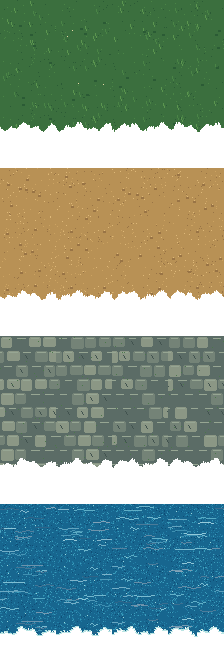
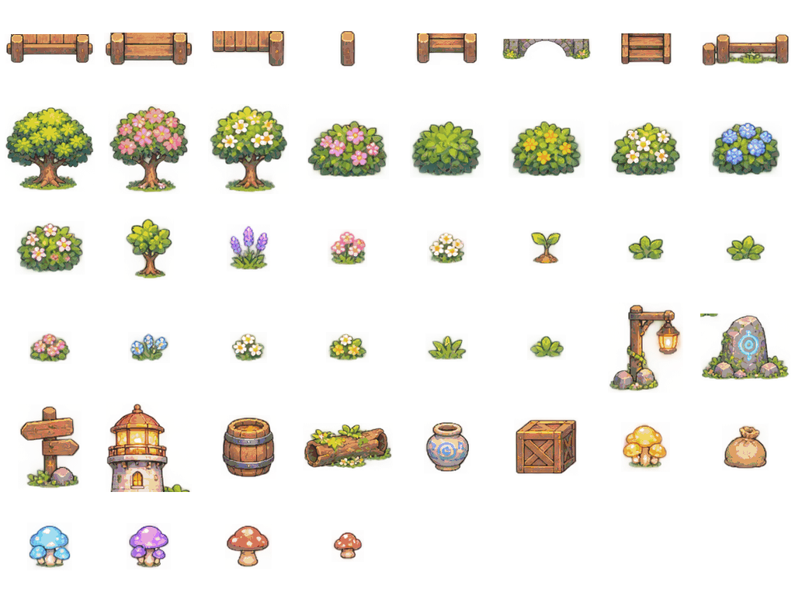
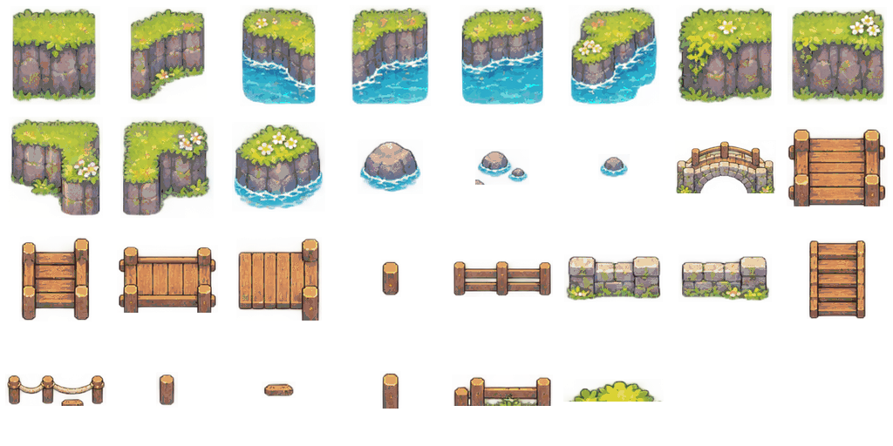
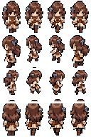
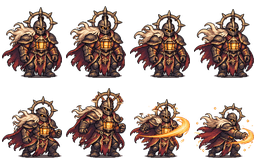

# 雾屿回响 · Mist Isle

  <strong>一段关于海岛、伙伴与失落灯塔的像素冒险。</strong> 
  <em>A handcrafted pixel-art adventure about an island, companions, and a lost lighthouse.</em>

  
  
  
  

---

## 游戏画面 / Art Gallery

  
  

  
  

游戏使用的地形、植被、区域道具与环境素材图集 / Terrain, flora, area props and environment atlases used in-game.

## 角色图鉴 / Character Gallery

  

主要角色与伙伴立绘 / Main cast and companion portraits.

  
  
  
  

旅者与三位伙伴的游戏内像素形象 / In-game pixel sprites of the traveller and three companions.

  
  

灯塔守卫与守望者 / The Lighthouse Guardian and the Watcher.

## 中文

### 关于游戏

《雾屿回响》是一款以探索和伙伴收集为核心的俯视角像素 RPG。玩家从海岸营地启程，穿过林地与潮汐遗迹，逐步揭开失落灯塔背后的故事。

### 第一章：海岛旅程

- **海岸营地**：旅程起点，与守望者相遇，在营火旁整备。
- **辉光林地**：探索发光植被与林间遗迹，感受专属萤火氛围。
- **潮汐遗迹**：在雨幕与古代机关之间寻找线索。
- **灯塔庭院**：穿过幽蓝火光与夜雾，迎战灯塔守卫，点亮最终祭坛。

### 玩法特色

- 探索式地图与逐步解锁的区域路线。
- 三位可加入队伍的伙伴，各自拥有独立形象与互动。
- 战斗、收集、对话、存档与章节结局。
- 按区域设计的天气：林地萤火、遗迹降雨、灯塔夜雾。
- 手工绘制与整理的像素角色、地形和环境素材。
- Windows 桌面版与 Raspberry Pi 5 ARM64 构建配置。

### 操作

| 按键 | 功能 |
|---|---|
| WASD / 方向键 | 移动 |
| E | 互动、对话、确认 |
| Shift | 冲刺 |
| Tab | 切换伙伴 |
| J | 旅程手记 |
| I | 背包 |
| M | 地图 |
| F5 / F9 | 保存 / 读取 |
| F7 | 天气调试切换 |
| O | 收起 / 展开目标栏 |
| Esc | 返回 / 关闭界面 |

### Windows 运行

推荐使用 Windows 10/11、CMake、Visual Studio C++ Build Tools 和 Python 3。

1. 克隆仓库：
       git clone https://github.com/xily99371-del/mist-isle.git
       cd mist-isle
2. 运行启动脚本：
       .\RUN_WINDOWS.bat

脚本会生成所需像素素材、配置 raylib 并编译游戏。也可以从 GitHub Actions 下载已打包的 Windows 版本。

### Raspberry Pi 5

项目提供 Raspberry Pi 5 ARM64 构建配置，采用更保守的 OpenGL 2.1 路径，并针对天气粒子与场景绘制做了性能预算。

详细说明见 [docs/RASPBERRY_PI5.md](docs/RASPBERRY_PI5.md)。

### 技术栈

- C11
- [raylib 5.5](https://www.raylib.com/)
- CMake
- Python + Pillow（开发期素材生成与地图校验）
- Tiled TMX/TSX（地图编辑与构建）
- GitHub Actions（Windows / Raspberry Pi 5 构建）

### 项目结构

    mist-isle/
    ├── assets/          # 角色、地形、环境与过场素材
    ├── docs/            # 设计与平台文档
    ├── maps/            # Tiled 地图与 tileset
    ├── src/              # C 游戏逻辑与渲染
    ├── tools/            # 素材生成、地图构建与校验
    ├── third_party/      # 第三方素材与许可证
    ├── CMakeLists.txt
    └── RUN_WINDOWS.bat

### 致谢与素材许可

项目原创角色与环境素材归项目所有。第三方素材仅按其原始许可使用；相关来源与许可证记录见 [ASSET_SOURCES_AND_LICENSES.md](ASSET_SOURCES_AND_LICENSES.md) 及 third_party 目录。

---

## English

### About

**Mist Isle** is a top-down pixel-art RPG focused on exploration and companion collection. Begin at a quiet coastal camp, travel through a luminous grove and tide-worn ruins, and uncover the story behind the island's lost lighthouse.

### Chapter One: An Island Journey

- **Coastal Camp** — The starting hub. Meet the Watcher and prepare beside the campfire.
- **Glowglade Grove** — Explore luminous plants and forgotten woodland paths under its signature firefly ambience.
- **Tidal Ruins** — Search ancient mechanisms through rain and weathered stone.
- **Lighthouse Courtyard** — Follow the blue flames through the night fog, face the Lighthouse Guardian, and awaken the final altar.

### Features

- Exploration-led hub-and-submap progression.
- Three recruitable companions with distinct identities and interactions.
- Combat, collectibles, dialogue, save/load, and a chapter finale.
- Region-specific weather: fireflies in the grove, rain in the ruins, and night fog at the lighthouse.
- Handcrafted pixel characters, terrain, and environment art.
- Windows desktop and Raspberry Pi 5 ARM64 build profiles.

### Controls

| Key | Action |
|---|---|
| WASD / Arrow keys | Move |
| E | Interact, talk, confirm |
| Shift | Dash |
| Tab | Switch companion |
| J | Journal |
| I | Inventory |
| M | Map |
| F5 / F9 | Save / Load |
| F7 | Weather debug cycle |
| O | Collapse / expand objectives |
| Esc | Back / close |

### Build on Windows

Recommended: Windows 10/11, CMake, Visual Studio C++ Build Tools, and Python 3.

1. Clone the repository:
       git clone https://github.com/xily99371-del/mist-isle.git
       cd mist-isle
2. Run:
       .\RUN_WINDOWS.bat

The script generates required pixel assets, configures raylib, and builds the game. A packaged Windows build is also produced by GitHub Actions.

### Raspberry Pi 5

An ARM64 build profile is provided for Raspberry Pi 5. It uses a conservative OpenGL 2.1 path and a reduced rendering budget for weather particles and scene effects.

See [docs/RASPBERRY_PI5.md](docs/RASPBERRY_PI5.md) for details.

### Technology

- C11
- [raylib 5.5](https://www.raylib.com/)
- CMake
- Python + Pillow for development-time asset generation and map validation
- Tiled TMX/TSX maps
- GitHub Actions for Windows and Raspberry Pi 5 builds

### Repository Layout

    mist-isle/
    ├── assets/          # Characters, terrain, environment and cinematic art
    ├── docs/            # Design and platform documentation
    ├── maps/            # Tiled maps and tilesets
    ├── src/              # C gameplay and rendering
    ├── tools/            # Asset generation, map building and validation
    ├── third_party/      # Third-party assets and licenses
    ├── CMakeLists.txt
    └── RUN_WINDOWS.bat

### Credits and Asset Licenses

Original project characters and environment art belong to the project. Third-party assets are used under their respective licenses. See [ASSET_SOURCES_AND_LICENSES.md](ASSET_SOURCES_AND_LICENSES.md) and the third_party directory.

---

雾屿回响 · Mist Isle — Version 1.0.0

