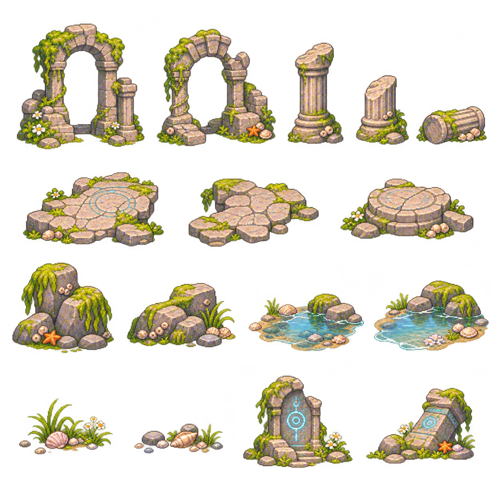
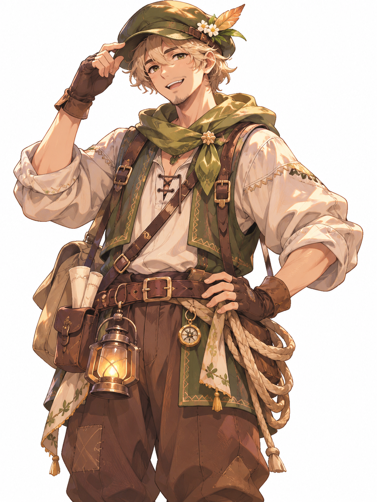
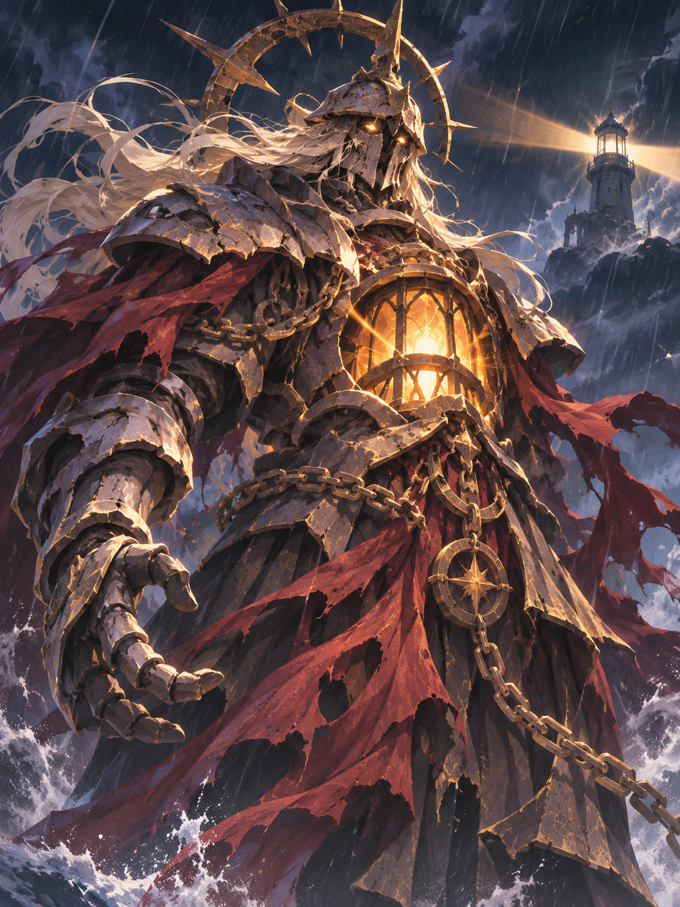
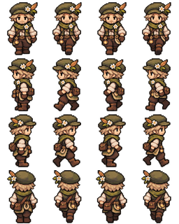

# 雾屿回响 · Mist Isle

<p align="center">
  <strong>一段关于海岛、伙伴与失落灯塔的像素冒险。</strong><br/>
  <em>A handcrafted pixel-art adventure about an island, companions, and a lost lighthouse.</em>
</p>

<p align="center">
  
  
  
  
</p>

---

## 最终地图素材 / Final Map Art — v8

<p align="center">
  
  
</p>
<p align="center">
  
  
</p>
<p align="center"><sub>四张最终地图专属素材图集，直接来自 MistIsle_MapArt_v8.zip。旧版通用地形图集不再作为最终地图美术展示。 / Four final area-specific art sheets extracted from MistIsle_MapArt_v8.zip. Earlier generic atlases are no longer presented as the final map art.</sub></p>

## 高清角色图鉴 / High-Resolution Character Gallery

<p align="center">
  
  
  
</p>
<p align="center"><sub>v7 最终高清角色立绘：女主角、守望者、灯塔守卫 / Final v7 high-resolution portraits: heroine, Watcher and Lighthouse Guardian.</sub></p>

<p align="center">
  
  
  
</p>
<p align="center"><sub>三位伙伴的 v7 高清独立立绘 / Final v7 individual high-resolution companion portraits.</sub></p>

## 游戏内像素形象 / In-Game Pixel Sprites

<p align="center">
  
  
  
</p>
<p align="center"><sub>以上三张角色动画均对应 src/render.c 中实际加载的文件路径 / All three sprite sheets use the exact paths loaded by src/render.c.</sub></p>
<p align="center">
  
  
  
</p>
<p align="center"><sub>三位伙伴同样使用游戏运行时加载的独立四帧动画素材 / Companion strips are the exact four-frame runtime assets.</sub></p>
<p align="center"><sub>高清对话立绘与游戏内像素动画分开展示。上述高清立绘来自 MistIsle_ApprovedArt_v7.zip，地图环境素材来自 MistIsle_MapArt_v8.zip。 / High-resolution dialogue portraits are shown separately from in-game pixel sprites. Portraits come from v7; environment art comes from v8.</sub></p>

## 中文

### 游戏简介

《雾屿回响》（Mist Isle）是一款俯视角像素 RPG。你将从海岸营地出发，探索一座被遗忘的海岛，与岛上的小生灵结伴，逐步恢复失落灯塔的力量。

v1.0.0 收录第一章完整旅程，包含四张相互连通的手工设计地图，以及从初次探索到灯塔最终仪式的章节流程。

### 第一章：失落的灯塔

- **海岸营地**：旅程起点，也是各区域之间的枢纽。与守望者交谈、整理物品，并从这里前往其他区域。
- **辉光林地**：在专属萤火天气中探索林地，帮助叶团、寻找果实，并与林地微光兽交锋。
- **潮汐遗迹**：在持续降雨的遗迹中寻找潮汐贝壳与星晶，解开机关并让鸣晶蜥加入队伍。
- **灯塔庭院**：穿过夜雾与幽蓝火光，挑战灯塔守卫，击败它后返回最终祭坛，触发章节结局。

### 伙伴

旅途中可以招募三位伙伴，并在探索时跟随、在战斗中协助：

- **苔灯灵（Moss Lumi）**：以星光治愈与微光攻击支援队伍。
- **沫尾兽（Moatail）**：使用泡泡水流，使敌人进入潮湿状态。
- **鸣晶蜥（Crystal Gecko）**：来自潮汐遗迹的晶体伙伴。

伙伴拥有独立像素形象、成长数据与战斗能力。通过 Tab 可以切换当前出战伙伴。

### 区域天气

- 海岸营地：晴朗、阵雨与阴云轮换，不出现夜雾。
- 辉光林地：进入时切换为专属萤火天气。
- 潮汐遗迹：进入时切换为雨天。
- 灯塔庭院：进入时切换为夜雾。

进入区域时会显示天气提示；离开后恢复对应区域的天气规则。

### 操作说明

| 按键 | 功能 |
|---|---|
| WASD / 方向键 | 移动 |
| 左 Shift | 冲刺 |
| E | 互动、对话、拾取、使用场景机关 |
| Tab | 切换当前出战伙伴 |
| J | 打开旅程手记 |
| I | 打开背包 |
| M | 打开地图 |
| O | 收起 / 展开目标栏 |
| F5 / F9 | 保存 / 读取存档 |
| F7 | 天气调试切换 |
| Esc | 关闭当前界面 |

标题界面可使用 Enter 或鼠标开始游戏；战斗界面支持键盘与鼠标选择指令。

### Windows 运行

推荐 Windows 10/11、CMake、Visual Studio C++ Build Tools 和 Python 3。

```powershell
git clone https://github.com/xily99371-del/mist-isle.git
cd mist-isle
.\\RUN_WINDOWS.bat
```

启动脚本会准备所需素材、配置 raylib 并编译游戏。也可以从 GitHub Actions 下载 Windows 构建产物。

### Raspberry Pi 5

项目提供 Raspberry Pi 5 ARM64 构建配置，针对设备采用独立的图形配置与粒子预算。

详细说明见 [docs/RASPBERRY_PI5.md](docs/RASPBERRY_PI5.md)。

### 技术栈

- C11 与 [raylib 5.5](https://www.raylib.com/)
- CMake 构建系统
- Python + Pillow：素材生成与地图校验
- Tiled TMX/TSX：地图编辑与构建
- GitHub Actions：Windows x64 与 Raspberry Pi 5 ARM64 自动构建

### 项目结构

```text
mist-isle/
├── assets/          # 角色、地图、环境与过场素材
├── docs/            # 项目与平台文档
├── maps/            # Tiled 地图与 tileset
├── src/             # C 游戏逻辑与渲染
├── tools/           # 素材生成、地图构建与校验
├── third_party/     # 第三方素材与许可证
├── CMakeLists.txt
└── RUN_WINDOWS.bat
```

### 素材与许可

最终角色素材以 `MistIsle_ApprovedArt_v7.zip` 为准，四张地图的环境素材以 `MistIsle_MapArt_v8.zip` 为准。第三方素材来源与许可证见 [ASSET_SOURCES_AND_LICENSES.md](ASSET_SOURCES_AND_LICENSES.md) 及 `third_party/`。

## English

### About the Game

**Mist Isle** is a top-down pixel-art RPG. Set out from a coastal camp, explore a forgotten island, befriend its small inhabitants, and restore the power of a lost lighthouse.

Version 1.0.0 contains the complete first-chapter journey across four handcrafted, connected areas—from the first steps on the island to the final lighthouse ritual.

### Chapter One: The Lost Lighthouse

- **Coastal Camp** — The starting hub and connection between regions. Talk to the Watcher, manage your inventory, and set out for the island's other areas.
- **Glowglade Grove** — Explore under its exclusive firefly weather, help Leafling, gather fruit, and face the Grove Mote.
- **Tidal Ruins** — Search the rain-soaked ruins for a Tide Shell and Star Crystal, solve the shrine mechanism, and recruit Crystal Gecko.
- **Lighthouse Courtyard** — Cross the night fog and blue flames, challenge the Lighthouse Guardian, then return to the final altar to trigger the chapter ending.

### Companions

Recruit three companions who follow you during exploration and assist in battle:

- **Moss Lumi** — Supports the party with starlight healing and luminous attacks.
- **Moatail** — Uses bubble streams to leave enemies in a wet state.
- **Crystal Gecko** — A crystal companion found in the Tidal Ruins.

Each companion has an individual pixel sprite, progression data and battle abilities. Press Tab to switch the active companion.

### Regional Weather

- Coastal Camp: clear, rain and overcast weather rotate; night fog is excluded.
- Glowglade Grove: entering the area activates its exclusive firefly weather.
- Tidal Ruins: entering the area activates rain.
- Lighthouse Courtyard: entering the area activates night fog.

An on-screen notice announces each area transition and its weather. Each region follows its own weather rules.

### Controls

| Key | Action |
|---|---|
| WASD / Arrow keys | Move |
| Left Shift | Dash |
| E | Interact, talk, pick up items and activate scene objects |
| Tab | Switch active companion |
| J | Open journal |
| I | Open inventory |
| M | Open map |
| O | Collapse / expand objectives |
| F5 / F9 | Save / load |
| F7 | Weather debug cycle |
| Esc | Close the current interface |

Press Enter or click the mouse to start from the title screen. Battle commands can be selected with the keyboard or mouse.

### Build on Windows

Recommended: Windows 10/11, CMake, Visual Studio C++ Build Tools and Python 3.

```powershell
git clone https://github.com/xily99371-del/mist-isle.git
cd mist-isle
.\\RUN_WINDOWS.bat
```

The launcher prepares required assets, configures raylib and builds the game. A packaged Windows build is also available from GitHub Actions.

### Raspberry Pi 5

The project provides a dedicated Raspberry Pi 5 ARM64 build profile with device-specific graphics settings and particle budgets.

See [docs/RASPBERRY_PI5.md](docs/RASPBERRY_PI5.md).

### Technology

- C11 and [raylib 5.5](https://www.raylib.com/)
- CMake
- Python + Pillow for asset generation and map validation
- Tiled TMX/TSX for map authoring and compilation
- GitHub Actions for Windows x64 and Raspberry Pi 5 ARM64 builds

### Repository Layout

```text
mist-isle/
├── assets/          # Characters, maps, environment and cinematic art
├── docs/            # Project and platform documentation
├── maps/            # Tiled maps and tilesets
├── src/             # C gameplay and rendering
├── tools/           # Asset generation, map building and validation
├── third_party/     # Third-party assets and licenses
├── CMakeLists.txt
└── RUN_WINDOWS.bat
```

### Art Assets and Licenses

The final character assets are defined by `MistIsle_ApprovedArt_v7.zip`; the four area-specific environment art sheets are defined by `MistIsle_MapArt_v8.zip`. Third-party asset sources and licenses are documented in [ASSET_SOURCES_AND_LICENSES.md](ASSET_SOURCES_AND_LICENSES.md) and `third_party/`.

---

<p align="center"><sub>雾屿回响 · Mist Isle — Version 1.0.0</sub></p>
